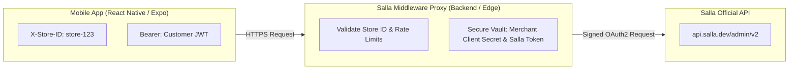

# 🛡️ Security Architecture & Multi-Store White-Label Guidelines

This document outlines the strict security principles, token handling protocols, and multi-tenant data isolation mechanisms implemented in the Salla Multi-Store Mobile Application.

---

## 1. Zero Secret Key Exposure Principle

### Architecture Pattern: Middleware Proxy
Mobile application binary bundles (iOS `.ipa` and Android `.apk` / `.aab`) can be reverse-engineered. **Never** include private merchant credentials or Salla OAuth client secrets within the React Native client code.



### Security Checklist:
- [x] **No Hardcoded API Keys**: All network requests pass through `src/api/client.ts` with only the public `X-Store-ID` header.
- [x] **Environment Sanitization**: `src/config/env.ts` includes runtime warnings in `__DEV__` if keywords like `SECRET`, `PRIVATE_KEY`, or `ACCESS_TOKEN` are detected in bundle environment variables.
- [x] **Middleware Managed Authorization**: Refresh tokens, webhook signatures, and merchant app credentials stay exclusively within the backend middleware.

---

## 2. Secure Session Storage (`expo-secure-store`)

User tokens (such as customer authentication JWTs) are managed using hardware-backed encrypted storage:
- **iOS**: Stored in the native iOS Keychain (`kSecClassGenericPassword`).
- **Android**: Stored using Android Keystore with AES-GCM encryption.
- **Web / Fallback**: Safe fallback to encrypted local storage.

Implementation in `src/api/client.ts`:
```typescript
import * as SecureStore from 'expo-secure-store';

export async function getCustomerAuthToken(): Promise<string | null> {
  return await SecureStore.getItemAsync('salla_customer_access_token');
}
```

---

## 3. Strict Store Data Isolation

To prevent data cross-contamination when switching stores or previewing multiple merchants:
1. **Zustand Cart Scope**:
   - Cart storage persists with store identifiers.
   - Resetting or switching active merchants clears or segregates local storage entries.
2. **TanStack Query Cache Keys**:
   - All server queries embed the active `storeId` in their cache key tuple:
   ```typescript
   queryKeys.products = (storeId: string, filters?: any) => ['store', storeId, 'products', filters];
   ```
   - When the merchant changes, query keys immediately diverge, ensuring zero cache leakage between distinct merchant catalogs.

---

## 4. White-Label Merchant Build Configuration

When creating standalone merchant builds for the App Store and Google Play:
1. Specify the active `STORE_ID` in `app.json` or `eas.json`:
```json
{
  "expo": {
    "extra": {
      "storeId": "store-oud-luxury",
      "apiUrl": "https://api.your-salla-middleware.com/v1"
    }
  }
}
```
2. Or pass via environment variable:
```bash
EXPO_PUBLIC_STORE_ID=store-roastery-cafe npx expo start
```
